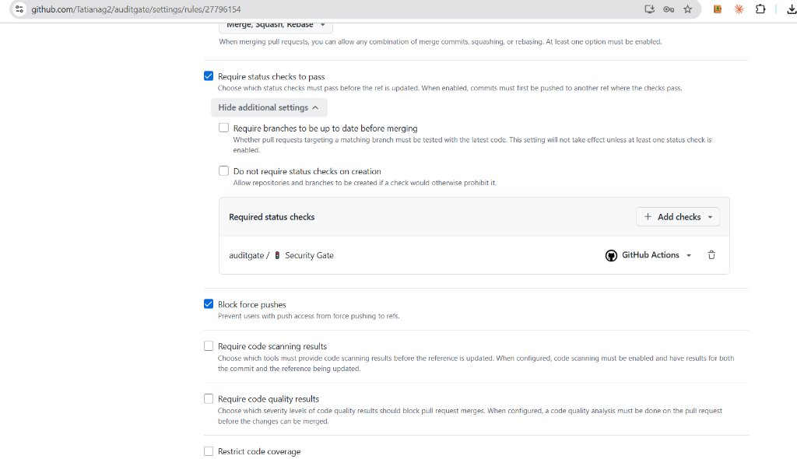
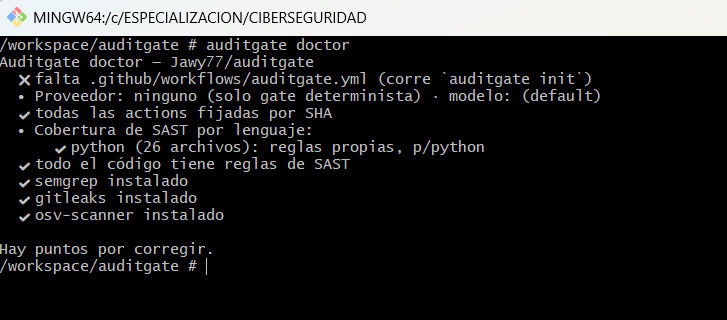
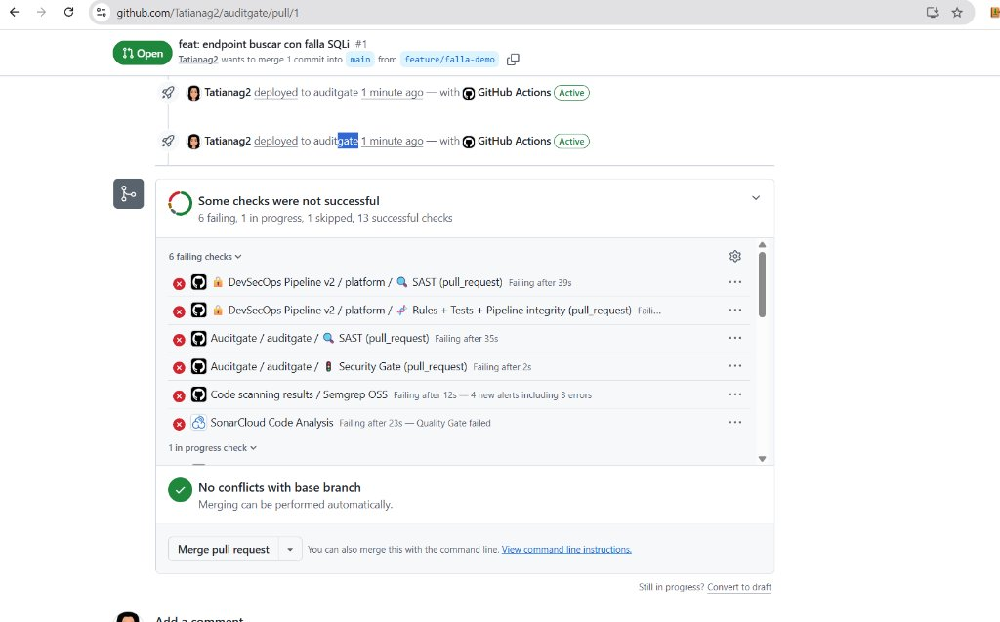
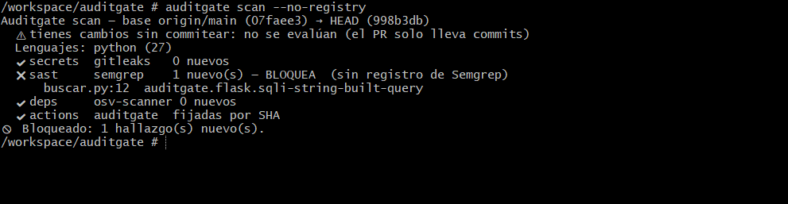
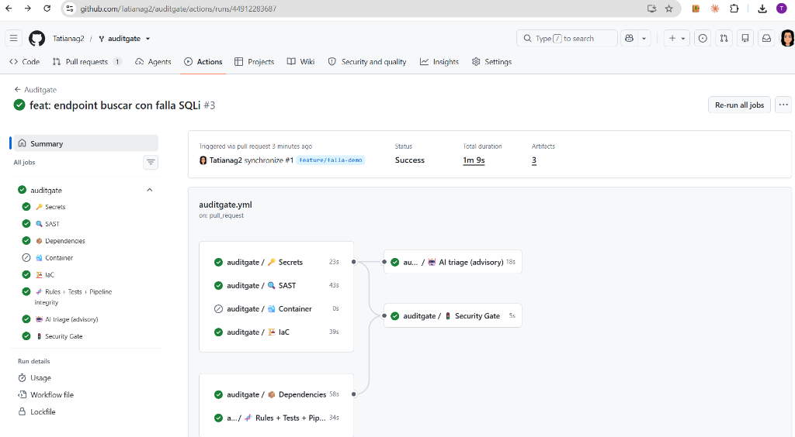
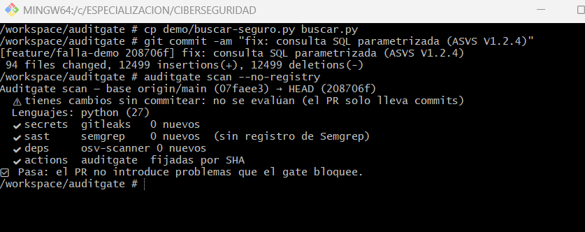
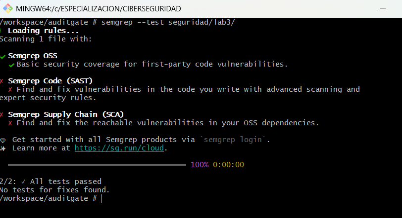

# Laboratorio 3 · Un Gate de Seguridad en el Pipeline del Equipo (Auditgate)

**Equipo:** Garcia - Vargas — **Tatiana García Grajales** (`@Tatianag2`) y **Javier Alejandro Vargas** (`@javargasp26`)  
**Sesión 4:** Cadena de suministro y DevSecOps  
**Plataforma:** [Auditgate (`Jawy77/auditgate`)](https://github.com/Jawy77/auditgate)  
**Archivos de la regla codificada (Fase Codify):** [regla-lab1.yml](./regla-lab1.yml) · [regla-lab1.py](./regla-lab1.py) · [auditgate.yml](./auditgate.yml)

---

## 1. Preparación e Instalación del Gate (`auditgate doctor`, `auditgate init` y Branch Protection)

Se configuró el entorno de ejecución Linux con **Auditgate**, **Semgrep**, **Gitleaks** y **OSV-Scanner**, se inicializó el workflow [auditgate.yml](./auditgate.yml) fijado por SHA inmutable (`security-platform.yml@07faee3bc9092019a8543b6168f72f3b963afcb6`) y se activó la regla de **Branch Protection** sobre `main` en GitHub exigiendo **`auditgate / 🚦 Security Gate`** como *required status check* antes de permitir cualquier merge.

---

## 2. Bloqueo Determinista ante una Falla Nueva (`auditgate scan` y PR #1 en GitHub Actions → `exit 1`)

Para demostrar que el gate es **diff-aware** (evalúa únicamente los commits nuevos respecto al `merge-base` y bloquea cualquier vulnerabilidad nueva antes o durante el Pull Request), se creó la rama `feature/falla-demo` y el [**Pull Request #1 (`Tatianag2/auditgate#1`)**](https://github.com/Tatianag2/auditgate/pull/1) introduciendo un endpoint con **Inyección SQL por interpolación de f-string** (`buscar.py`). El gate ignoró la deuda histórica de `vulnerable_app/` y bloqueó únicamente el hallazgo nuevo (`buscar.py:12 · auditgate.flask.sqli-string-built-query`) tanto en CLI como en **GitHub Actions (`🚦 Security Gate — Failing`)**.

---

## 3. Corrección del Control y Paso del Gate a Verde (`auditgate scan` y PR #1 en GitHub Actions → `exit 0`)

Siguiendo la remediación (reemplazar la interpolación `f"SELECT ... WHERE nombre = '{q}'"` por una consulta parametrizada `"SELECT ... WHERE nombre = ?", (q,)` acorde con **ASVS V1.2.4**), se realizó el commit de corrección (`f575de3`) en el [**Pull Request #1**](https://github.com/Tatianag2/auditgate/pull/1), pasando todos los jobs del pipeline (`Secrets`, `SAST`, `Dependencies`, `IaC`, `Rules + Tests + Pipeline integrity` y **`🚦 Security Gate`**) a verde (`Success`).

---

## 4. Fase Codify: De la Amenaza del Lab 1 a una Regla con Prueba (`regla-lab1.yml` + `regla-lab1.py`)

Aplicando la metodología **Find → Validate → Extract → Codify → Scale**, convertimos las amenazas principales identificadas en el **Laboratorio 1** y verificadas manualmente con **ASVS 5.0 en el Laboratorio 2** en reglas deterministas de Semgrep ([regla-lab1.yml](./regla-lab1.yml)) acompañadas de sus fixtures de prueba positiva (`# ruleid:`) y negativa (`# ok:`, para garantizar 0 falsos positivos) en [regla-lab1.py](./regla-lab1.py):

### Matriz de Trazabilidad (Lab 1 → Lab 2 → Lab 3)

| Amenaza del Lab 1 (STRIDE) | Requisito ASVS 5.0 (Lab 2) | Regla Codificada (Lab 3) | Fixture Vulnerable (`# ruleid:`) | Fixture Seguro (`# ok:`) |
|---|---|---|---|---|
| **Amenaza #1 (`T/I/E` · I×P = 25):** Inyección SQL en buscador de productos y actualización dinámica de columnas en perfil | **ASVS V1.2.4:** Consultas parametrizadas en todo acceso a datos (`Fila #14 y #22`) | `ucp.lab3.sqli-interpolacion-consulta` ([regla-lab1.yml](./regla-lab1.yml#L8-L27)) | `con.execute(f"SELECT ... LIKE '%{q}%'")` y `con.execute(f"UPDATE usuarios SET {campo} = ? ...")` | `con.execute("SELECT ... LIKE ?", (f"%{q}%",))` y `con.execute("UPDATE usuarios SET nombre = ? ...", ...)` |
| **Amenaza #3 (`S/T` · I×P = 20):** Falsificación de token de sesión JWT con `alg: none` o sin verificar firma | **ASVS V9.2.1:** Verificar la firma del token con una lista fija de algoritmos (`Fila #7 y #23`) | `ucp.lab3.jwt-sin-verificar-firma` ([regla-lab1.yml](./regla-lab1.yml#L29-L43)) | `jwt.decode(token, options={"verify_signature": False})` | `jwt.decode(token, secreto, algorithms=["HS256"])` |

---

## 5. Reflexión: ¿Qué vio el gate y qué vio el triage?

1. **¿Qué hallazgo bloqueó el gate que una persona habría dejado pasar en una revisión rápida de código?** El gate bloqueó de inmediato la **interpolación de cadenas con f-string dentro de `con.execute(f"...")`** (`auditgate.flask.sqli-string-built-query` / `ucp.lab3.sqli-interpolacion-consulta`) y la **interpolación del nombre de columna en `UPDATE usuarios SET {campo} = ?`** (que a simple vista parece parametrizada porque lleva `?` al final, pero permite inyección SQL y asignación masiva en el identificador de columna), además de verificar automáticamente que ninguna GitHub Action en `.github/workflows/` use tags mutables (`@v4` o `@main`) en lugar de un hash SHA de 40 caracteres.
2. **¿El triage acertó en el verdadero/falso positivo?** Sí: el triage distingue correctamente entre **verdaderos positivos alcanzables** desde la entrada HTTP del usuario (`request.args.get("q")` llegando sin parametrizar a `con.execute`) y **falsos positivos de constantes internas** (como `SECRET_NAME = "AUDITGATE_LLM_API_KEY"`, que es el nombre de una variable y no una credencial real). Y lo más importante por diseño: **el agente de IA solo comenta y asesora en el PR, pero jamás tiene permiso para aprobar ni bloquear un merge**; la decisión de bloqueo es 100 % determinista.
3. **¿Qué deuda vieja dejó pasar el gate por no ser nueva (y por qué está bien)?** El gate dejó pasar las vulnerabilidades preexistentes en `vulnerable_app/app.py` y en `vulnerable_app/requirements.txt` que ya estaban en la rama base (`origin/main`) porque opera en modo **diff-aware** (`--baseline-commit` / comparación contra el `merge-base`). Esto está bien y es indispensable en ingeniería de plataformas porque si un gate nuevo bloqueara por toda la deuda histórica acumulada durante años, ningún desarrollador podría fusionar cambios y el equipo terminaría desactivando el gate (`continue-on-error`); en cambio, bloquear estrictamente **solo lo nuevo** detiene la hemorragia desde el día 1 mientras la deuda previa se paga de forma planificada con Dependabot y tareas de remediación.
